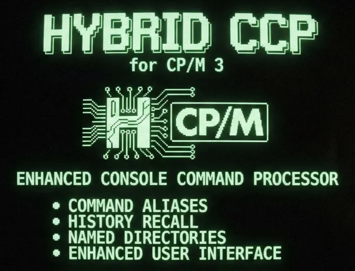

# A "New" Z80-Based Hybrid CCP (Console Command Processor) for CP/M+ (v3) - By RCL9

<div style="text-align:center">
    
</div>

## A High Level Overview

*CCP3-RCL* is a revised version of Digital Research's CCP for CP/M 3 which is ideally targeted for a memory constrained and non-banked Z80 computer (such as my 52k Exidy Sorcerer) and which otherwise may have slow disk access to files. More importantly, it provides a ZCPR3/Z3Plus/NzCOM user experience but without the bloat, higher memory usage or slower disk accesses.

In short, its primary benefits over existing solutions of the mid to late 1990s are:

- Compilable on any modern CP/M based emulator, or a real CP/M 2.2 or 3 machine.
- Based on my Z80-port of the original Digital Research CCP, with all commands & fixes/patches added.
- ZCPR3-like [command aliases](/Aliases.md) (written by me) from an easily editable *Aliases.cmd* file. Very fast, no disk access. 
- ZCPR3-like [named directories](/Named_Directories.md) from an easily editable *ROOT.DIR* file. Very fast, no disk access. 
- [Command recall](/HistoryRecall.md) via either the 1986-era *Hist.com* or *Hist30.com* programs. Very fast, no disk access. 
- No reliance on either NzCOM, Z3Plus or ZPM. 
- (Note: ZPM + ZCCP is not a solution due to its requirement of a banked Z80 computer)

Using the stock and original DRI CP/M 3 CCP (which has minimal features) has been a hair pulling experience for me as there is no command recall, aliases nor named directories - that forced me to create this refined project. 

For those that are not aware of them, NzCOM and Z3Plus are follow-on, early 1990s implementations of the well known ZCPR3 replacement CCP ecosystem used by many ardent CP/M 2.2 users in the 1980s. I started using the replacement ZCPR v1 CCP on my Exidy Sorcerer as of January 22 1983. Unfortunately NzCOM takes up a good chunk of memory and can be slow to access disk-based alias, named directory and/or command recall files on my 2Mhz Exidy Sorcerer.  I do have Z3Plus running on my Exidy Sorcerer, under CP/M 3 and John Monahan's "Dual SD Card" S-100 board, but alas it also exhibits similar performance bottlenecks.

This repo also provides:

- [Runtime files](/Z3Plus) to allow NzCOM and Z3Plus to run on the Exidy Sorcerer as well as code fixes to *SAlias16.com*.
- A good primer and well documented code on how to write a medium-complexity RSX module for the CP/M 3 operating system (written by me).
- A complementary subset of my highly curated set of [CP/M 2.2 and 3 command line uilities](/CPM_Utilities.md) that augment this hybrid CCP system.

## Category links:

[How to Install](#how-to-install)

[Speed Comparisons](#speed-comparisons)

[Usable TPA for the Exidy Sorcerer](#usable-tpa-for-the-exidy-sorcerer)

    
[Command History Recall Mechanisms](/HistoryRecall.md)

[Named Directories ](/Named_Directories.md)

[Command Aliases Mechanism](/Aliases.md)

[Modified Runtime Behavior of the CCP](#modified-runtime-behavior-of-the-ccp)

[Complementary CP/M Utilities for the CCP](/CPM_Utilities.md)

    
[Why Was This System Written and Unified?](#why-was-this-system-written-and-unified-)

[Why Not Use Existing Systems from the 1986-1993 Era?](#why-not-use-existing-systems-from-the-1986-1993-era-)

[How to (Optionally) Compile and Link](#how-to-compile-and-link)

## How to Install

- On your existing CP/M 3 boot disk, rename "ccp.com" to "ccp-dri.com" so that it no longer becomes the default CCP at warm boots.

- Copy the files from the [Distribution](/Distribution) directory and the {CP/M Utilities}(/Distribution/CPM_Utilities.md) sub-directory to your CP/M 3 boot disk. Copy "CCP3RCL9.com" to "ccp.com" so that it becomes the default CCP. 

- Edit the *ROOT.dir* file with the named directory mappings for your system. This will get loaded via *SetDIR.com* at start-up

- Edit the *Aliases.cmd* file to your own liking. This will get loaded via *AliasLdr.com* at start-up

- Append various start-up commands to your CP/M 3 *Profile.sub* file such as the following:

```
; New CCP cmds: LstAlias, AliasNam, cls, Dirnames, ListEsc
setdef *,A:,B: [order=(COM,SUB),temporary=A:]
; Alias listings cmds: ALI, Aliases, LstAlias, AliasNam
AliasLdr.com
; Load the named directories from file ROOT.DIR
Setdir.com
dirnames
; Hist30.com uses 2816 bytes vs. 2048 bytes for Hist.com
; Hist or Hist30 must come last or else command line corruption
; Hist30.com
hist.com
```

Note: *Hist.com* or *Hist30.com* must come last in the *Profile.sub* file or else the CPM3 command line entry code will become corrupted and unusable.

From that *Profile.sub* list above, you will want to choose between using *Hist.com* and *Hist30.com*; the latter has much greater functionality but at the cost of a bit more TPA memory. 

## What Does This Repo Offer For You?

- Source code to the November 1982 version of DRI's CCP, ported by me from 8080 over to Z80 mnemonics. The patches of John Elliott and of DRI (May 1998) are included. This could be considered a new base-line source listing of a Z80-based DRI CCP for others to build upon and expand in the future. 

- Source code to my new alias command processor system (loader, RSX, text file parser and translator + example Aliases.cmd file). This is entirely new code written from scratch and which took me quite a long time to get working without the usage of any local Z80 debugger. 

- Integration of Jim Lopushinsky's named directory mechanism from his CCP+ v1.05 of July 14 1986 into my revised Z80 CCP, with a slightly revised SetDIR.COM.

- Original copies of Jim Lopushinsky's HIST history recall program for CP/M 3 (July 25 1986) and Stuart Rose's HISTORY recall program for CP/M 2.2 and 3 (Nov 6 1986). I had actually used the HISTORY program as my history recall program from 1986 to 1990+ on my CPM 3 based [Cypher Z80/68k computer](<https://github.com/rcl9/Cypher-Z80-68000-Single-Board-Computer-1984-by-Motel-Computers---History-and-Documentation>). I tweaked up both of these programs to provide an adequate amount of history buffers while trying to reduce their memory footprint; I also added 'help info' in the stand-up text banner so that you will not have to refer to the documentation files upon every boot-up.

- Inclusion of some other useful CP/M 3 utilities into the Distribution directory such as RSXDIR.COM, RSXMAP.COM and TPASIZE.COM which can come in handy for evaluating this new system.

- Inclusion of my Z3Plus configuration and runtime files. In addition, I am including my modified SAlias v1.6 alias editor which I had to modify with an expanded stack segment to work reliably on my system.

- As a side benefit, it provides a fairly good example of how a CP/M 3 RSX module (of moderate complexity) can and should be written + compiled and linked. I had wasted a good bit of time to make it functional as I had initially planned. 

## Why Was This System Written and Unified?

I had spent the last 9 months trying to get NzCOM and Z3Plus up and running on my CP/M 2.2 and CP/M 3 operating systems on my 2Mhz 52k Exidy Sorcerer (which I maintain both of their CP/M 2.2 and 3 source code implementations) . I have a lovely, pimped out version of CP/M 3 running on the Yaze.AG emulator and hence missed its wonderful user experience on my Exidy Sorcerer which offered no command recall, no command aliases and no named directories. I especially wanted to have a command alias mechanism to map to my highly curated set of CP/M utility programs. I also did not want to have the lag with these add-on utilities going to disk to access their state information (such as used with the history mechanism of the CCP+ v1.05 program).

It has also been 40 years since I had done a lot of intensive CP/M operating system coding and hence found this to be an interesting challenge to get "back in the groove" and to re-learn RSX programming concepts. Additionally, I am openly documenting this work and the final system for the benefit of others who may be in the same boat as myself with a limited TPA on their CP/M 3 systems in these more modern times. 

## Why Not Use Existing Systems from the 1986-1993 Era?

I really did not want to waste so much time having to write my own system but my hands were tied since there was just nothing available that suited my requirements, as noted above. Each existing solution had its pros and cons, which I'll enumerate in this section.

History recall mechanisms:

| System       | Pros and Cons                                                                                                          |
|:------------ |:---------------------------------------------------------------------------------------------------------------------- |
| Stock CP/M 3 | Command recall (Ctrl-W) only available in banked systems                                                               |
| Hist.com     | Small footprint but awkward to use and semi-buggy                                                                      |
| Hist30.com   | The best of the bunch but consumes a bigger chunk of TPA                                                               |
| CCP+ v1.05   | Slow due to save/load of history data to CP/M files; no built-in commands                                              |
| NzCOM        | Not too bad but slow to start up and not usable on a 52k machine. Slower to access disk-based state information files. |
| Z3Plus       | My go-to solution but not entirely viable on a 52k machine. Slower to access disk-based state information files.       |
| ZCCP + ZPM   | The "best" for modern setups but only works on banked Z80 systems                                                      |

Alternatives to my new CCP system:

| System     | Pros and Cons                                                                                                               |
|:---------- |:--------------------------------------------------------------------------------------------------------------------------- |
| CCP+ v1.05 | No built-in commands (to keep its footprint small). Has named directories and history recall (slow) but no command aliases. |
| NzCOM      | See notes above                                                                                                             |
| Z3Plus     | See notes above                                                                                                             |
| ZCCP + ZPM | The "best" for modern setups but only works on banked Z80 systems                                                           |

## Usable TPA for the Exidy Sorcerer

With the 4K of static RAM in my modified "RAM-Pack" and 48K of main DRAM, my Exidy Sorcerer is rather limited in running CP/M 3 with 52k. I may have the only known personal implementation of CP/M 3 on the Exidy Sorcerer as CP/M 3 became dominant long after the peak popularity of the Sorcerer in the very early 1980s. Additionally, CP/M 3 is suited only for machines with lots of banked memory (and a main 64k primary bank) and not for a non-banked system like a 52k Sorcerer. Nonetheless, I spent considerable time tweaking CPM 3 and my BIOS+BDOS to squeeze out all available TPA memory space.

Based on real and current statistical data, this is the available TPA with the various aforementioned systems in place:

CP/M 3 plus the various RSX modules as provided in this project:

| System                                 | TPA Size | Bytes Used   |
|:-------------------------------------- |:-------- |:------------ |
| Plain CP/M 3 system (no modules)       | 41,478   |              |
| RCL9's alias command processor RSX     | 40198    | 1,280 bytes  |
| Hist.com (192 byte buffer size)        | 39,430   | 2,048 bytes  |
| Hist30.com (9 x 40 byte buffers)       | 37,126   | 2,816 bytes  |
| Named directories (via the SetDIR RSX) | 40,198   | 1,279 bytes  |
| Alias + Hist30 + SetDIR                | 34,822   | 6, 656 bytes |

CP/M 3 + Z3Plus:

| System                           | TPA Size | Bytes Used  |
|:-------------------------------- |:-------- |:----------- |
| Plain CP/M 3 system (no modules) | 41,478   |             |
| Z3Plus (full)                    | 34,054   | 7,424 bytes |
| Z3Plus (small)                   | 37,382   | 4,096 bytes |

Hence, my system with the 3 RSX modules loaded uses 6,656 bytes (with Hist30) compared to 7,424 bytes of TPA memory for Z3Plus. The benefit of my system is that the look-up buffers are in memory and hence there is instantaneous look-ups of the aliases, named directories and history recall. 

And comparison with CP/M 2.2 + NzCOM:

| System                             | TPA Size | Bytes Used  |
|:---------------------------------- |:-------- |:----------- |
| Plain CP/M 2.2 system (no modules) | 46,086   |             |
| NzCOM                              | 40,198   | 5,888 bytes |

Notes: NzCOM runs under my version of CP/M 2.2 for the Morrow DJ2D floppy disk controller (with my z80bios4.mac and zccp12.mac). Z3Plus runs under my version of CP/M 3 for John Monahan's *Dual SD Cards* S-100 board and *ZFDC floppy controller* S-100 board (non-banked, with a recompiled/fixed DRI BDOS3 and custom Z-80 BIOS for the Exidy Sorcerer). 

## Speed Comparisons

Not only is memory footprint important but also the time it takes from starting up CP/M 3 to getting the first command prompt (both with my new CCP system and that of Z3Plus or NcCOM). The following timing test comparisons were made with my 2Mhz Exidy Sorcerer running CP/M 3 off of the Dual SD S-100 board by John Monahan and CP/M 2.2 +NzCOM running off of the [Morrow DJ2D S-100 floppy controller](<https://github.com/rcl9/Morrow-DISK-JOCKEY-2D-Floppy-Disk-Controller-for-S100-Bus>) with a HxC 8in floppy emulator attached.

| System                                                       | Start-Up Speed                                 |
|:------------------------------------------------------------ |:---------------------------------------------- |
| Stock CP/M 3                                                 | 9sec before loading profile.sub (Dual SD Card) |
| Loading of Profile.sub                                       | +4sec                                          |
| Completion of Profile.sub (Setdef + Alias + Hist30 + SetDIR) | +10sec                                         |
| Z3Plus                                                       | 9 sec CP/M 3 boot time + 11sec = 20sec         |
| Z3Plus (small)                                               | 9 sec CP/M 3 boot time + 11sec = 20sec         |

Thus a complete load of CP/M 3, the Profile.sub file and loading of the 3 RSX modules takes *23 seconds*. This includes the time to parse the ALias.cmd file and the ROOT.DIR named directories file (which thereafter do not need to be parsed again in real time after each command is entered on the CCP command line). This is to be compared with the *20 seconds* to boot just CP/M 3 itself and then the two-stage Z3Plus loading process; this time does not include the time to parse any additional files that Z3Plus may reference such as its own Alias.cmd file.

And for timing comparison with my CP/M 2.2 system running off of a HxC floppy emulator (8in drive):

| System            | Start-Up Speed                        |
|:----------------- |:------------------------------------- |
| Stock CP/M 2.2    | 6sec (HxC floppy emulator, 8in drive) |
| NzCOM             | +40sec                                |
| NzCOM via NzBlitz | +12sec                                |

## Modified Runtime Behavior of the CCP

The CCP basically behaves exactly the same as the original DRI's CCP (as chosen by myself, given that it runs pretty smoothly).

However, I added 5 new built-in commands:

| New CCP Command  |  Description |
|:----------- |:----------------------------------------- |
| LstAlias        | List all of the aliases in the currently loaded Aliases.cmd file via AliasLdr.com | 
| AliasNam    | Lists just the names of the aliases | 
| DirNames    | List the named directories as presently loaded in from the ROOT.DIR file via the setdir.com program | 
| Cls        | Clear the screen on the Exidy Sorcerer | 
| ListEsc        | List the terminal ESCape sequences baked of the Exidy Sorcerer and the EXON3 monitor ROM by Walter Blady | 

You can also type *Aliases* on the command line to list the entire contents of the *Aliases.cmd* file. This is actually an alias defined in that file. 

With *AliasLdr.com* invoked at start-up, entering a CCP command via the command line, or via a CCP Submit file, will have the command translated through the Aliases.cmd mapping file.

With *SetDIR.COM* invoked at start-up, the Drive/User + directory name will be prepended to the 'A>' prompt. "SetDIR.com off" will disable it. 

With *Hist.com* or *Hist30.com* invoked at start-up, command recall will be available via their associated Control-key mappings. I have added helpful info text to their start-up banners so that you will not have to refer to their help documentation files. 

## How to Compile and Link

I am providing runtime Z80 binaries in the [Distribution]/Distribution) directory and hence you should not have to compile and link the code yourself. Figuring out how to do this, 40 years later, was a minor thorn in my side! However, it can easily be done by following these simple suggestions. 

### The *CCP3RCL9.com*, *AliasLdr.com* and *SetDir.com*:

- Copy the [Src](/Src) directory your CP/M computer or emulator running CP/M 2,2 or 3. For myself, I love using my pimped-out Yaze.AG emulator running CP/M 3.
- Execute the compilation process via *sub make* or *submit make*.
- Copy the three .com files back to your PC and add them to your main CP/M 3 boot disk. Copy *ccp3rcl.com* to *ccp.com* as well so that it becomes the default CCP upon warm starts. 

### The *Hist.com* command line recall program. This was written by Jim Lopushinsky, July 25 1986

I am providing a copy of the [original 1986 files](/History-Recall/Hist-Lopushinsky/Original) and a copy of my bug-fixed "SetDIR.mac".
    
I am also providing a snapshot of [my own recompilation](/History-Recall/Hist-Lopushinsky/RCL9 ). I have set the total history buffer length to be 192 bytes to save on TPA memory space. Copy those files to your CP/M system then execute *sub make*. This will generate the files *Hist.com* and *HistClr.com*. 

### The *Hist30.com* command line recall program (and *HistClr.com* to clear the buffers). This was written by Stuart Rose, Nov 6 1986

I am providing a copy of the [original 1986 files](/History-Recall/Hist-Rose/Original) for easier access by others.
    
 I am also providing a snapshot of [my own recompilation](/History-Recall/Hist-Rose/RCL9). I have reduced each of the 9 history buffers from 128 to 40 characters to save on TPA memory space. Copy those files to your CP/M system then execute "submit hist30". This will generate the file *Hist30.com*. 
